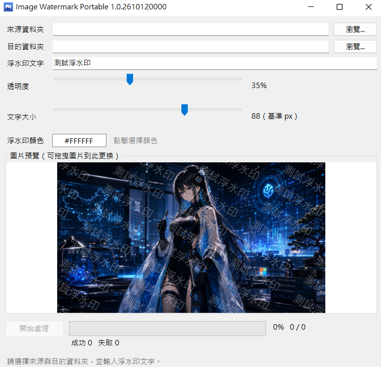

# Image Watermark Portable

**幾個點擊，替整個資料夾的照片加上自己的文字浮水印。**

Image Watermark Portable 是一款給 Windows 使用的輕量批次浮水印工具。選好照片資料夾、輸入文字並挑選顏色，就能預覽效果並一次處理整批圖片。下載單一執行檔即可使用，不需要另外安裝 .NET。



## 讓批次加浮水印變簡單

- **樣式由你決定**：輸入繁體中文、英文或數字，自選浮水印顏色、透明度與文字大小。
- **先看效果再處理**：開啟程式就有範例照片可預覽；調整設定時預覽同步更新，也可以把自己的圖片拖到預覽區查看。
- **一次處理整個資料夾**：包含子資料夾，輸出時保留原本的資料夾結構與檔名。
- **圖片格式照舊**：支援 JPG、PNG、WebP，輸出維持原格式與像素尺寸；PNG 透明背景也能處理。
- **處理進度一目了然**：處理中預覽會跟著目前圖片更新，並顯示進度、成功與失敗數量。
- **遇到壞圖不會整批中斷**：失敗項目會記錄在目的資料夾的 `watermark-errors.log`，其他圖片繼續處理。

浮水印會以左上至右下的斜向方式重複排列。若輸出位置已有同名圖片，程式會以新結果取代；來源圖片不會被修改。

## 開始使用

1. 從本專案下載 [`ImageWatermarkPortable.exe`](dist/ImageWatermarkPortable.exe)，在 Windows 10/11 x64 上執行。
2. 選擇照片的**來源資料夾**與**輸出資料夾**。
3. 輸入浮水印文字，調整顏色、透明度與大小；預覽區會顯示目前效果。
4. 按下「開始處理」，完成後到輸出資料夾查看加上浮水印的圖片。

來源與輸出資料夾請選擇不同且互不包含的位置，避免把輸出圖片再次當作來源處理。

## 建置

若要從原始碼建置，需要 .NET 10 SDK：

```powershell
dotnet test .\ImageWatermarkPortable.slnx -c Release

dotnet publish .\src\ImageWatermarkPortable\ImageWatermarkPortable.csproj `
  -c Release -r win-x64 --self-contained true `
  -p:PublishSingleFile=true -p:EnableCompressionInSingleFile=true
```

## 注意事項

- 動畫 WebP/PNG 目前不支援，會記錄在錯誤日誌並略過。
- 輸出以維持圖片尺寸與畫面效果為主；拍攝資訊等 metadata 不保證完整保留。
- 影像處理使用 SixLabors.ImageSharp，採 Split License。商業使用前請確認符合該套件的授權條款。
